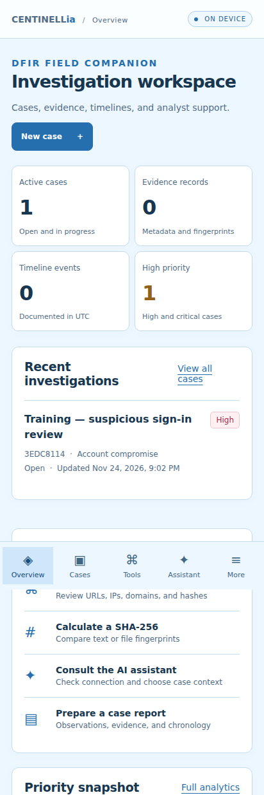

  
  <h1>CENTINELLia</h1>
  
<strong>DFIR Field Companion · Android 1.0.0</strong> Beacon of the Eagle LLC · Centinell Suite Defense project

An offline field workspace for documenting cybersecurity investigations. This first release combines case records, observations, four written response checklists, indicator extraction, SHA-256 hashing, and portable reports. The interface is in English.

## Included

- Cases with priorities, statuses, categories, and timestamped observations.
- Per-case checklists for phishing, account compromise, malware triage, and data exposure.
- Pattern extraction for IPv4, domains, URLs, emails, MD5, SHA-1, and SHA-256, including common defanged forms. Results are explicitly unverified.
- Local SHA-256 calculation for UTF-8 text or a user-selected file, with expected-hash comparison.
- Case report export, JSON workspace backup, validated import, and deletion controls.
- Android file selection and export through the system document picker, with no broad file-storage permission.

There is no AI model connection in 1.0.0. These tools do not detect malware, establish chain of custody, or provide a tamper-evident audit system. Records are stored locally without a separate application encryption layer. Use authorized collection tools and your organization's procedures.

## Preview and tests

Run `npm test` (Node 22 or newer). Run `npm run preview`, then visit `http://localhost:4173`. Browser tools share the same interface as the Android app. UI automation is in `tests/ui.test.cjs` and requires Playwright plus Chromium; it is a development dependency only and is not shipped in the app.

## Android build

Open this directory in Android Studio with Android SDK 36, JDK 21, and Gradle 8.13 installed. Alternatively, use the **Android build** workflow in GitHub Actions. Run `gradle lintDebug assembleDebug bundleRelease`.

- `app/build/outputs/apk/debug/app-debug.apk`: signed debug build for internal device testing only.
- `app/build/outputs/bundle/release/app-release.aab`: **unsigned** release bundle until an upload signing key is configured.
- Minimum Android 8.0 (API 26); target/compile Android 16 (API 36).

The workflow does not publish the app. See [the release checklist](play-store/RELEASE.md) for signing, device tests, and store setup. Never commit upload keys or their passwords.

## Privacy and support

See [PRIVACY.md](PRIVACY.md). Support: centinellsuite@gmail.com.

## Screenshots

Screenshots show fictional, clearly labeled training data. They demonstrate the shared UI in Chromium; they are not proof of Android device testing.

Copyright © 2026 Beacon of the Eagle LLC. All rights reserved. No open-source license is granted by this repository.
