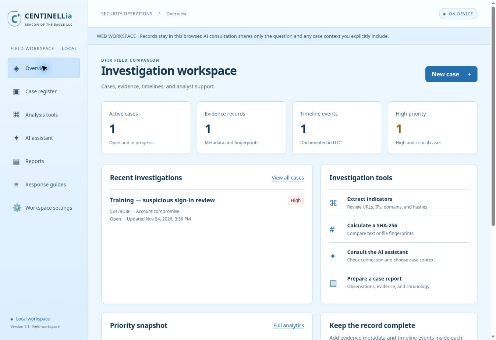

# CENTINELLia · Sky Edition 1.1.0

**Beacon of the Eagle LLC · Centinell Suite Defense project**

[Open the private web workspace](https://centinellia-field-companion.centinellsuite.chatgpt.site). For a portable copy, download [index.html](index.html) with GitHub's Download raw file button and open it in a browser.

## What changed

- Pale sky-blue and white interface, navy text, larger labels, and simpler mobile navigation.
- Evidence metadata register per case: source, custodian, acquisition time in UTC, SHA-256, and notes. Original files are not copied into the workspace.
- Event chronology with event time, recorded time, source, and verification state.
- Reports and analytics calculated from saved records, including priority charts, case status, evidence counts, and event counts.
- Complete TXT reports, case JSON, spreadsheet-safe register CSV, and print/save-PDF support.
- Local text lab for Base64, URL encoding, and line-ending normalization; decoded content is never executed.
- AI consultation UI and authenticated server-only OpenAI gateway. It remains explicitly unconfigured until a runtime API credential is supplied. No model answer is simulated.

The Android app opens the AI workspace separately in a browser. Local Android records are not automatically copied there. The owner-private web audience is preserved.

## Existing records and backups

The local storage key is preserved. Backup format 2 adds evidence and chronology. This release reads both format 1 and 2, preserving older observations and response checklists. Older 1.0 apps cannot read format 2; retain an original backup when moving between versions.

## Android

Package: `com.beaconoftheeagle.centinellia`. Version 1.1.0 (version code 2). Android 8.0+; target/compile API 36.

Run `./gradlew lintDebug assembleDebug bundleRelease` or use the [Android build workflow](https://github.com/Centinell2025/CENTINELLia/actions). The workflow's release AAB is unsigned until signing is configured; owner-delivered signed packages and the upload key are handled separately. Never commit signing keys or credentials.

## Development checks

`npm test` checks record migration, validation, reports, spreadsheet escaping, and AI gateway access, explicit context, error handling, and request pacing. `tests/ui.test.cjs` exercises phone/desktop UI flows, evidence, chronology, reports, the local text lab, and explicit AI-context consent using a labeled test-only provider response. `tests/android-smoke.py` checks offline launch and native file hashing in an Android 16 emulator.

The hosted Site uses `scripts/build-web.mjs` with its retained hosting manifest. The Worker bundles the UI and keeps API credentials server-side. See [AI connection notes](web/README.md).

## Limits and privacy

This is an analyst workspace. It does not scan devices, detect malware, or establish a tamper-evident chain of custody. AI output is unverified until a human checks it. Local records have no separate application encryption layer. Read [PRIVACY.md](PRIVACY.md) and the [release checklist](play-store/RELEASE.md).

Support: centinellsuite@gmail.com. Copyright © 2026 Beacon of the Eagle LLC. All rights reserved.
